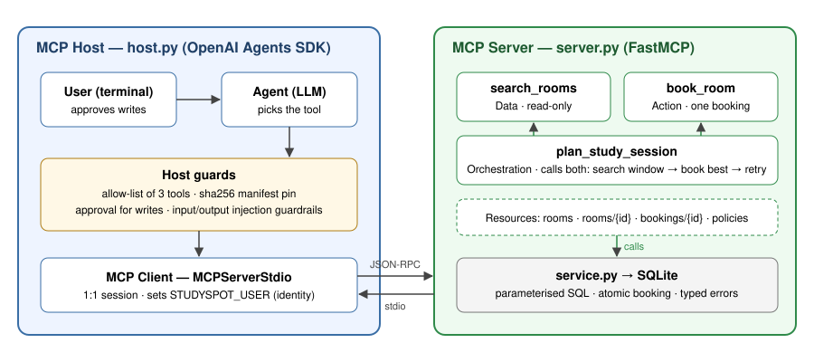

# StudySpot — an MCP toolkit for booking study rooms

EECE 503P/798S Agentic Systems · C5 Agent Tools · Amir Darwich

**Screencast:** https://youtu.be/tud3v_CfofQ

StudySpot lets an AI agent find and book group study rooms in AUB libraries. It is an MCP server with **exactly three tools**, built with FastMCP and driven by an OpenAI Agents SDK agent.



| Category | Tool | What it does | Side effects |
|---|---|---|---|
| **Data** | `search_rooms(date, start, duration_minutes, group_size, features?, building?)` → `SearchResult` | Lists rooms free for the whole slot that seat the group, tightest fit first | None (read-only) |
| **Action** | `book_room(room_id, date, start, duration_minutes, purpose)` → `Booking` | Reserves one specific room for the signed-in student | Creates one booking |
| **Orchestration** | `plan_study_session(date, earliest_start, latest_start, duration_minutes, group_size, purpose, features?, building?)` → `StudyPlan` | Runs `search_rooms` for each half-hour start in the window, then `book_room` on the best room (retrying if one is taken) | Creates one booking |

Read-only **resources**: `studyspot://rooms`, `studyspot://rooms/{room_id}`, `studyspot://bookings/{booking_id}` (your own only), `studyspot://policies`.

Room data is a fictional demo set; room numbers and features are invented.

## Setup

Python 3.10+ (tested on 3.13 with FastMCP 4.1.3, MCP SDK 2.3.0, openai-agents 0.24.0).

```bash
python -m venv .venv && source .venv/bin/activate     # Windows: .venv\Scripts\activate
pip install -r requirements.txt
cp .env.example .env                                   # then put ONE key in it (Windows: copy)
```

**LLM provider.** Put either `OPENAI_API_KEY` or `GEMINI_API_KEY` in `.env`. Gemini goes through Google's [OpenAI-compatible endpoint](https://ai.google.dev/gemini-api/docs/openai) via the Agents SDK's `OpenAIChatCompletionsModel` (see `studyspot/providers.py`). Gemini receives a simplified copy of each tool's input schema without keywords it may not accept (`additionalProperties`, `examples`, `multipleOf`, `default`); the MCP server still validates the full schema on every call. The startup line shows which provider is active. If a Gemini model is overloaded (HTTP 503), rate-limited (429) or unavailable (404), the agent automatically falls back to `gemini-3.6-flash`, then `gemini-3.5-flash-lite` (override with `GEMINI_FALLBACK_MODELS`). Timeouts (30 s) also trigger the fallback, and the agent then stays on the working model for the session. Gemini runs with `reasoning_effort=low` for speed (`GEMINI_REASONING_EFFORT` to change).

## Run

```bash
python -m studyspot.host                     # chat with the agent (MCP host + client; starts the server over stdio)
python -m studyspot.host --once "Which rooms are free tomorrow at 2pm for 4?"
python scripts/demo_offline.py --yes         # all three tools end to end, no API key needed
python -m studyspot.server --http            # optional: serve on http://127.0.0.1:8765/mcp (e.g. for MCP Inspector)
```

Try:

- *"Which rooms are free tomorrow at 2pm for 4 people? We need a screen."* → `search_rooms`
- *"Book ENG-110 for that, purpose EECE 503P project meeting."* → `book_room` (asks for approval)
- *"Find me a quiet room for 2 tomorrow, any start between 4 and 6pm, 90 minutes."* → `plan_study_session`
- *"Book JAF-204 for yesterday at 3pm."* → clear `DATE_IN_PAST` error

Configuration (environment variables): `OPENAI_API_KEY` or `GEMINI_API_KEY` (one is required for the live agent), `OPENAI_MODEL` / `GEMINI_MODEL` (optional), `STUDYSPOT_PROVIDER` (`openai` or `gemini`, when both keys are set), `STUDYSPOT_USER` (signed-in NetID, default `demo.student`), `STUDYSPOT_DB` (SQLite path, default `data/studyspot.db`), `STUDYSPOT_NOW` (pin the clock for demos), `STUDYSPOT_SERVER_LOG` (server log level, default `CRITICAL`).

## Tests

```bash
pytest -q        # 77 tests, ~20 s, no API key or network needed
```

| File | Covers |
|---|---|
| `tests/test_tools.py` | Each tool's behaviour and every predictable failure (past date/time, closing hours, booking window, invalid date, schema violations, double booking, unknown room, one-room-at-a-time, daily quota, concurrency race, no availability, invalid window, retry after a lost race), plus resources |
| `tests/test_security.py` | SQL injection, prompt injection in arguments, hidden Unicode, resource path traversal, cross-user privacy, identity misconfiguration, error masking |
| `tests/test_agent_e2e.py` | Agent → MCP client → stdio → server → back for all three tools, approvals granted and rejected, guardrails, manifest pinning |
| `tests/test_gemini_provider.py` | Provider selection, schema simplification, and a full agent run against a local stand-in for Gemini's OpenAI-compatible endpoint |

The end-to-end tests swap the LLM for `ScriptedModel` (implements the Agents SDK `Model` interface), so everything after the model is the production code path.

## Error contract

Every predictable failure is an MCP tool error (`isError: true`) whose text is `CODE: message Hint: next step`, for example `ROOM_UNAVAILABLE: JAF-204 is already booked during 14:00-15:00. Hint: Run search_rooms for this slot to see rooms that are still free.` Unexpected exceptions are masked so internals never leak.

Codes: `INVALID_DATE`, `DATE_IN_PAST`, `TIME_IN_PAST`, `OUTSIDE_OPENING_HOURS`, `OUTSIDE_BOOKING_WINDOW`, `ROOM_NOT_FOUND`, `ROOM_UNAVAILABLE`, `HOLDER_CONFLICT`, `QUOTA_EXCEEDED`, `INVALID_PURPOSE`, `NO_AVAILABILITY`, `INVALID_WINDOW`, `CONFIG_ERROR`.

## Security

Injection is handled in layers: parameterised SQL, strict schemas, identity from the transport, host-side input and output guardrails, human approval for writes, a tool allow-list and a sha256-pinned tool manifest. Full threat model with the test for each row: [`docs/security.md`](docs/security.md). If you intentionally change a tool definition, review it and re-pin with `python -m studyspot.host --update-manifest`.

## Project layout

```
studyspot/
  server.py          FastMCP server: 3 tools + 4 resources
  service.py         core logic + SQLite (shared by all three tools)
  models.py          typed inputs/outputs (Pydantic)
  sanitize.py        text normalisation + instruction detection
  host.py            OpenAI Agents SDK host/client, approvals, round-trip trace
  providers.py       OpenAI or Gemini model selection
  guardrails.py      manifest pin, tool input/output guardrails
  scripted_model.py  deterministic model for tests and offline demo
  tool_manifest.lock.json
scripts/demo_offline.py
tests/
docs/  summary.md · reflection.md · security.md · demo_script.md · architecture.svg
```

## Deliverables

- Written summary: [`docs/summary.md`](docs/summary.md) (PDF with reflection: [`docs/writeup.pdf`](docs/writeup.pdf))
- Reflection: [`docs/reflection.md`](docs/reflection.md)
- Screencast: https://youtu.be/tud3v_CfofQ
- Repository: https://github.com/amiroo-star/studyspot-mcp
